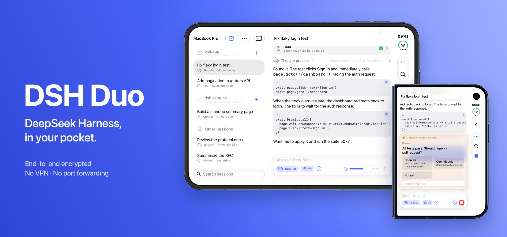
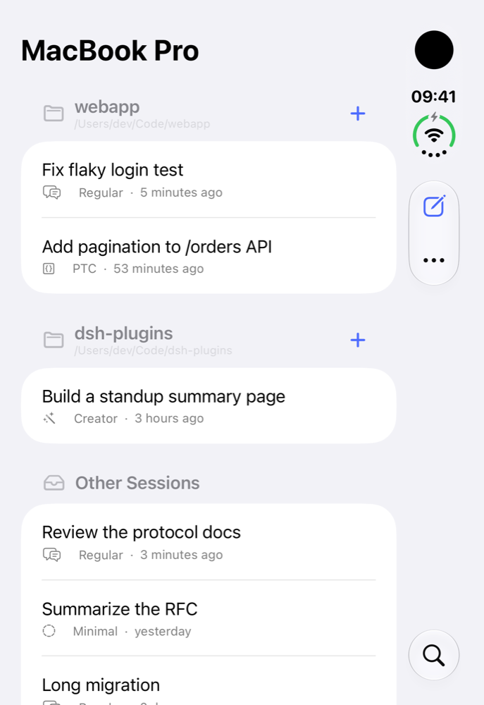
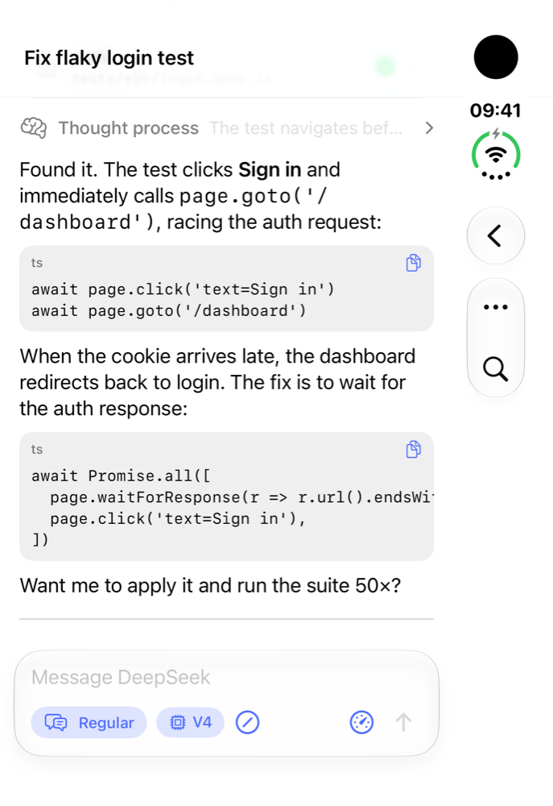
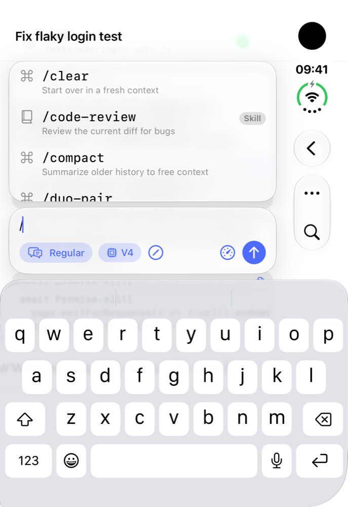
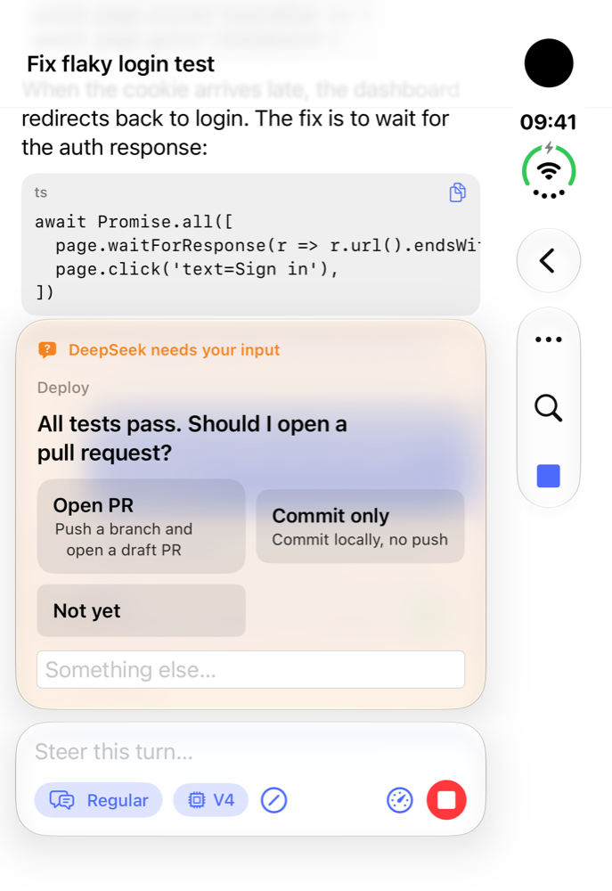
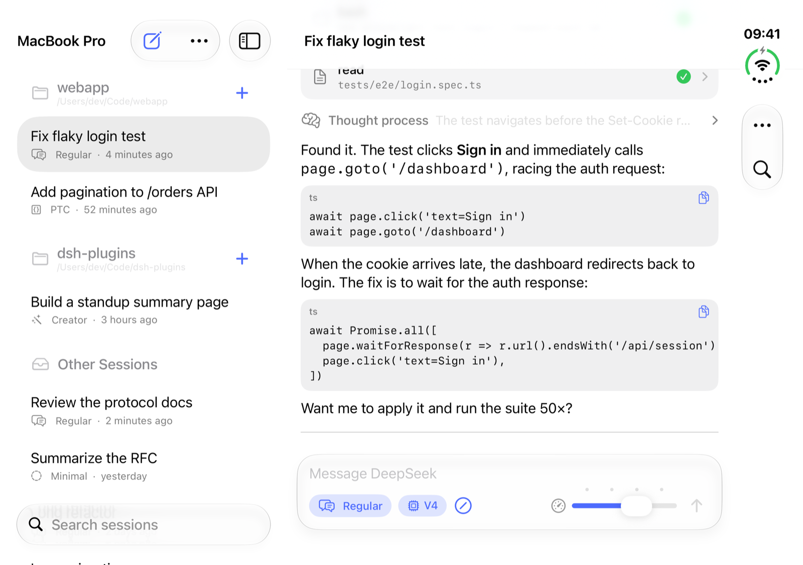
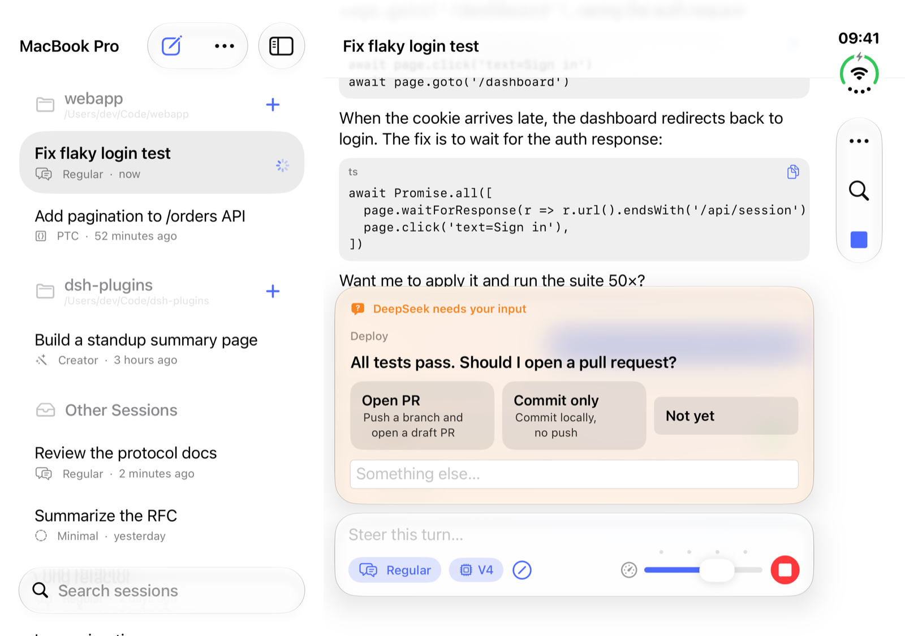

<p align="center">
  
</p>

# DSH Duo

A native SwiftUI remote for [DeepSeek Harness](https://github.com/deepseek-ai/deepseek-harness) (`dsh`), designed for
**iPhone Duo** and following Apple's [Designing for iPhone Duo](https://developer.apple.com/design/human-interface-guidelines/designing-for-iphone-duo)
guidelines. Install the companion plugin on the machine that runs dsh, scan a QR code, and drive your sessions from
anywhere: no VPN, no port forwarding, end-to-end encrypted.

<p align="center">
  
  
  
  
</p>
<p align="center"><sub>Sessions · Streaming replies and code · Slash commands · Questions answered in one tap</sub></p>

```
 iPhone Duo app  ──wss──▶  relay (forwards ciphertext)  ◀──wss──  dsh + dsh-plugin-duo-remote
       ▲                                                             │
       └──────────── APNs push, signed with your own team's key ─────┘
```

Both ends dial **out** to the relay, so neither needs a public address. Every message is sealed with AES-256-GCM using a
key that only the phone and your dsh share (it travels in the pairing QR code). The relay sees routing envelopes and
ciphertext only. See [docs/PROTOCOL.md](docs/PROTOCOL.md).

| Folder | What it is |
|---|---|
| [`ios/`](ios) | SwiftUI app, Notification Service Extension, unit tests (XcodeGen `project.yml` + generated `.xcodeproj`) |
| [`plugin/`](plugin) | `dsh-plugin-duo-remote`: the dsh bundle the phone talks to |
| [`relay/`](relay) | Zero-trust WebSocket relay (Node or Cloudflare Workers); holds no secrets |
| [`docs/PROTOCOL.md`](docs/PROTOCOL.md) | Pairing, key derivation, relay frames, app messages |

## What the app does

- **Sessions on the left.** A `NavigationSplitView` sidebar groups sessions by workspace with live running and
  waiting-for-you badges, search, swipe-to-rename and context menus. On the inner display it sits beside the open session;
  on the outer display it collapses to one column.
- **Subagents in place.** Delegated conversations nest under the session that started them, with their own mode,
  running badge and transcript. A continuable child takes follow-ups; a finished one-shot child opens read-only.
- **Detail pane.** On the open inner display with the sidebar hidden, tapping a thought or tool call opens it in full
  in a pane on the right; swipe it away or tap ✕ to close it. Elsewhere they expand inline.
- **Models and thinking levels.** A composer chip lists every provider's models from the Host's catalog, with the
  model's reasoning efforts (for example Low / Medium / High / Max).
- **Thinking, tool calls and messages.** Streaming thinking (collapsible), tool calls with arguments, results and status,
  Markdown replies with copyable code blocks, and command output.
- **Photos and files.** The paperclip attaches photos from the library or any file from the Files app. Images show as
  thumbnails in the conversation, files as named cards, and both open in QuickLook; Markdown images in replies are
  drawn as pictures too. Attachments upload in relay-sized chunks, so a large screenshot or log arrives intact.
- **Withdraw a queued message.** A message sent while a turn runs waits as a quiet bubble; press and hold it to cancel
  before DeepSeek starts on it.
- **Regular, PTC, Minimal and Creator modes.** These map to dsh's `standard`, `ptc`, `minimal` and `cordis` agent
  presets, plus any custom presets. dsh fixes a session's mode at its first turn, so picking a new mode on a started
  session offers a new session in the same folder.
- **New workspaces.** Browse folders on the Mac and register one.
- **Slash commands, listed automatically.** Type `/` (or tap the slash button) to get the session's dsh commands and
  skills, filtered as you type. Commands run on the Host without a model turn.
- **Notifications.** You're notified when a turn finishes or when DeepSeek asks a question, with inline **Reply** /
  **Answer** actions. A turn you stop yourself isn't pushed to your phone. In the foreground these are local
  notifications for sessions you aren't viewing. When the app is closed, your Mac's dsh plugin sends them through APNs
  with the push key of the team that signed your copy of the app; the Notification Service Extension decrypts them on
  the phone. No Apple key ever reaches the shared relay.
- **Questions.** DeepSeek's `ask_user_question` appears as a card above the composer. A single choice answers in one
  tap.
- **Goals above the composer.** The current objective sits in a compact strip with its phase and round budget, and its
  menu can pause, resume, edit or clear it. A blocked goal explains why; a completed goal steps aside.
- **Haptics on every button.** Taps, selections, success, warning, error, and a two-beat "attention" pattern for
  questions.

### iPhone Duo specifics

<p align="center">
  
  
</p>
<p align="center"><sub>Unfolded, the sidebar sits beside the open session and question options spread across the inner display.</sub></p>

- Standard toolbars throughout, so the system places controls on the vertical side axis. Items use `Label` (title +
  symbol), `ToolbarItemGroup`, `.visibilityPriority(.high)` for primary actions, and `ToolbarOverflowMenu` instead of a
  custom "…" menu.
- `.toolbarVerticalCompressionBehavior(.prefersToolbarItems)` on the session screen, which is task-oriented.
- `ArrangementView` for the full-screen session and the onboarding screen; navigation stays outside it.
- `ReservedRegion` (via `GeometryProxy.reservedRegions(kind:)`) in `FoldAware`, which keeps custom floating components
  (the composer, banners, the full-screen exit button) clear of the fold and the active inner camera.
- Grids use an even number of columns (mode cards, question options) so they divide cleanly at the fold.
- Size-class driven layout with no fixed widths; deployment target iOS 27.1.

### Liquid Glass

Follows Apple's [Liquid Glass](https://developer.apple.com/documentation/technologyoverviews/liquid-glass) guidance:

- **Standard components carry the glass.** Bars, sheets, menus, toolbars and the split view use the system
  appearance with no custom backgrounds. Sheet actions use `Button(role: .cancel / .confirm / .close)`, and buttons
  use system styles: `.glass` for the full-screen exit button, `.glassProminent` for primary calls to action on
  content, and `.bordered` / `.borderedProminent` inside glass surfaces.
- **Custom glass only on key functional elements:** the composer, the command list, question cards and the
  transient banner. They share one `GlassEffectContainer`, so they blend and morph (`glassEffectID`) instead of
  stacking glass on glass.
- **Scroll edge effect.** The composer stack is a `safeAreaBar`, so content scrolling beneath it gets the system
  scroll edge effect.
- **Concentric shapes.** Custom glass uses `.rect(corners: .concentric(minimum:), isUniform: true)` to stay concentric
  with the display and its containers.
- **Toolbars:** icon items with accessibility labels, Stop and the overflow menu as separate items with a
  `ToolbarSpacer(.fixed)`, conditional items rather than hidden views, and the system overflow menu.
- **Restrained color.** The accent color has light, dark and increased-contrast variants. Action sheets are anchored
  to the control that opens them, and section headers use title-style capitalization.
- **Layered app icon.** `App/AppIcon.icon` is an Icon Composer document: flat SVG layers over a system gradient, so
  the system supplies the glass, lighting and the dark, clear and tinted variants.

## Quick start

1. **Plugin.** On the machine running dsh:

   ```bash
   dsh plugin add dsh-plugin-duo-remote
   ```

   Start dsh (the desktop app or `dsh web`) and open **iPhone** in the sidebar. The pairing code is there, and the page
   shows each paired phone, whether notifications are on, and an **Unpair All Phones** button.
   The plugin uses the public relay at `https://dsh-duo-relay.cloudflare-hybrid809.workers.dev` by default, so there is
   nothing else to set up. It only ever carries ciphertext. To run your own relay instead, see
   [relay/README.md](relay/README.md) and set `DSH_DUO_RELAY` or the plugin's `relay` option.

2. **App.** Connect your iPhone Duo and sign your own copy with the team signed in to Xcode:

   ```bash
   ios/scripts/install.sh --apns-key ~/Downloads/AuthKey_XXXXXXXXXX.p8
   ```

   This archives with automatic signing (bundle ID `ai.deepseek.harness.duo.<your team id>`), exports a signed `.ipa`
   to `ios/build/export/`, installs it on the connected iPhone and launches it. With `--apns-key` (an APNs key from
   developer.apple.com, Certificates, IDs & Profiles, Keys), it also stores that key in `~/.dsh/duo-remote/` so your dsh
   can push to this app while it's closed. Restart dsh afterwards. Without the key everything works except
   notifications while the app is closed. Then scan the pairing QR code, or paste the link.

## Developing without a DeepSeek key

The plugin ships a demo Host that simulates dsh (streaming replies, tool calls, questions, commands) around the real
plugin:

```bash
cd relay && npm install && npm start
```

```bash
cd plugin && npm install && node dev/demo-host.ts --relay http://127.0.0.1:8787
```

Open the printed `dshduo://` link in the simulator: `xcrun simctl openurl booted '<link>'`.

## Tests

```bash
cd relay && npm test
```

```bash
cd plugin && npm test
```

```bash
cd ios && xcodebuild -project DSHDuo.xcodeproj -scheme DSHDuo -destination 'platform=iOS Simulator,name=iPhone Duo' test
```

The plugin's end-to-end test runs the real relay, the plugin on a fake dsh Host, and a simulated phone over the sealed
protocol. The iOS tests include crypto interop with a box sealed by the Node plugin.
